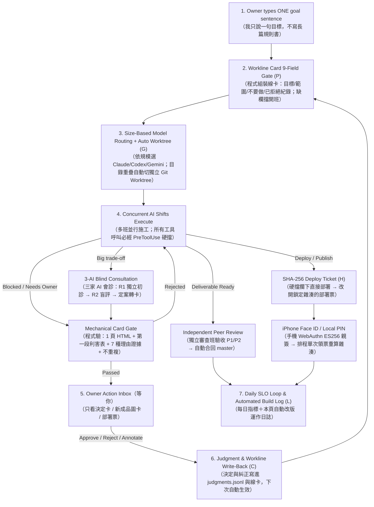
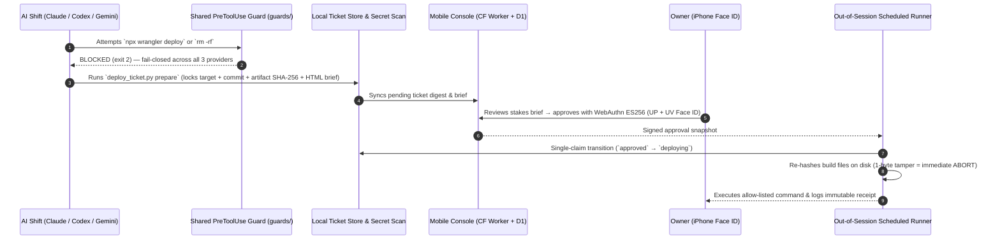
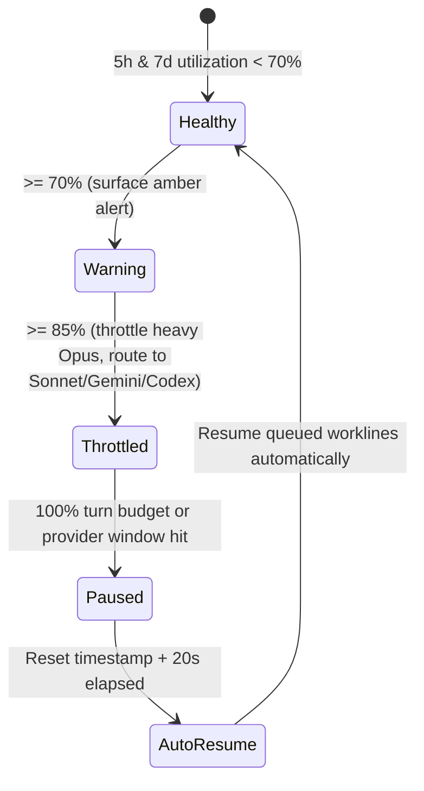

# Hi, I'm Harry (Aiden) Chou 👋

**I am not a programmer — I designed and operate a local multi-agent console ([Agent Ops Console](https://github.com/akaiguitar-dot/agent-ops-console), Apache-2.0) to direct Claude, Codex, and Gemini on real production projects every day.**

> **Core Principle:** *Spend human judgment only where it matters — once.*  
> **核心理念：** 算力與三家 AI 額度都買得到、換得掉，全系統唯一加不了量的是「人的判斷力」。這套系統的目標不是讓 AI 吐出更多字，而是**讓人的判斷力和專注力只花在最有價值的地方；判斷過一次就存成資料，下次由程式把關，不再問第二次。**

---

## 0. Why This Exists: The Judgment Layer & Human-Machine Boundary
### 為什麼要做這套系統：人、程式、AI 的明確邊界

Running one AI in a chat tab is easy. Running **10+ concurrent shifts across Anthropic Claude, OpenAI Codex, and Google Gemini** on a real codebase immediately hits four structural failures that prompt instructions alone cannot fix:

1. **Silent File Clobbering（靜默互蓋檔案）** — Two agents edit the same directory concurrently; last writer wins and erases verified work without raising an error.
2. **Self-Approved Irreversible Actions（AI 自己核准上線）** — An agent hallucinates *"deployment approved"* and runs `wrangler deploy`, `rm -rf`, or outbound social API `POST` calls directly.
3. **Decision Fatigue & Chat Noise（聊天室洗版與重複提問）** — Agents stream hundreds of tool-call lines and re-ask questions the owner already rejected last week, burying the few moments where human judgment actually matters.
4. **Unannounced Quota Collisions（額度靜靜燒光）** — Parallel shifts hit rolling 5-hour limits or re-pay cold prompt caches until the entire team stalls mid-turn.

My solution is to split responsibilities cleanly across **Code (deterministic rules)**, **AI (execution & analysis)**, and **Human (judgment & final sign-off)**:

| Layer | Who Owns It | Concrete Responsibilities | Why This Boundary Matters |
|---|---|---|---|
| **Judgment & Sign-off（判斷與簽核）** | **Human (Me)** | Set goals, inspect first-look visual samples, answer evidence-backed Decision Cards, approve Deploy Tickets via **iPhone Face ID** | Human attention does not scale; I only touch **3 checkpoints** (goal / sample / final sign-off) |
| **Mechanical Governance（機械治理）** | **Deterministic Code** | Workline card 9-field gate, Git worktree auto-isolation, `PreToolUse` hard firewall, 4-layer secret scan, SHA-256 deploy tickets, quota pacing | Reminders in Markdown drift and get ignored; code gates fail closed (`exit 2`) 100% of the time |
| **Execution & Audit（施工與互審）** | **Claude · Codex · Gemini** | Research, code, tests, UI/data builds, 3-AI blind consultations, independent cross-shift peer reviews | Models are replaceable labor; state lives in local files on my host PC, never locked inside one vendor |

---

## 1. End-to-End Operating Workflow (Full Lifecycle)
### 端到端完整操作程序全景圖

Every task—from a one-sentence idea in my head to a live production deploy—follows the same closed loop. Nothing relies on an AI "remembering" yesterday's rules.

---

## 2. Step-by-Step Operating Playbook (With Diagrams & Real Screenshots)
### 六階段操作程序詳解（流程邏輯 ＋ 圖表 ＋ 真實桌面工作台截圖）

> **Screenshot honesty note:** Every screenshot below is captured directly from the real, unmodified Windows desktop workbench (`workflow-desktop`, Edge WebView2 shell) running on an isolated off-screen desktop — **not a hand-drawn mockup**. UI labels are in Traditional Chinese; shift names and counts inside the screenshots are de-identified demo fixtures.

---

### Stage 1 · Kickoff Without Markdown Rulebooks (Foundation P — Workline as Prompt)
**第一階段：一句話開工 —— 用「工作線卡」取代龐大 MD 規則書，自動隔離多班並行**

#### The Problem With Traditional Setup
Most multi-agent setups accumulate dozens of project Markdown files (`CLAUDE.md`, specs, notes) that humans forget to update and agents selectively ignore. Worse, when two shifts edit the same folder on one working tree, the second save silently overwrites the first.

#### How I Actually Operate It
1. I open the main thread (**`跟架構班說`**) and type a single goal sentence (e.g., *"Fix the API cache race condition and add pre-commit secret-scan tests; don't ping me with progress, raise a card only when you need a decision or deploy"*).
2. The engine reads the single-writer state file and automatically builds a **9-field Workline Card** for that track. If any mandatory field is missing, the shift is blocked from opening:

| # | Workline Card Field | What It Enforces Automatically |
|---|---|---|
| 1 | **Goal（目標）** | One verifiable objective; prevents scope drift |
| 2 | **Done Criteria（完成標準）** | Split into machine-checkable items + visual items requiring human inspection |
| 3 | **Editable Scope（可改範圍）** | Directory allow-list; edits outside scope are flagged in review |
| 4 | **Do-Not-Do（不要做）** | Hard constraints pulled directly from past owner corrections |
| 5 | **Templates & Benchmarks（樣板與案例）** | Prevents agents from reinventing visual style from scratch |
| 6 | **Next Step（下一步）** | Enables automatic hand-off continuation without waiting for me to say *"continue"* |
| 7 | **Dependencies（依賴）** | Blocks premature dispatch when upstream work is unfinished |
| 8 | **Owner Judgments（判過與拒絕）** | **Key mechanism:** anything I previously rejected is injected here so the next shift never re-proposes it |
| 9 | **Has Look-and-Feel?（有沒有長相）** | Forces a cheap first-look sample before spending compute on a full render or build |

3. The engine picks the model by objective task size (small tasks → Gemini / Sonnet subagent; medium → Sonnet; large architecture / sensitive paths → Opus + mandatory independent review). When two editing shifts touch overlapping directories, `worktree_guard` automatically spins up an isolated **Git worktree** per shift.
4. In the screenshot below, notice the right-hand shift pane: verbose tool runs collapse into `做了 9 步,其中 1 步重試後完成`, and when the agent attempts `npx wrangler deploy`, the shared `PreToolUse` hard guard intercepts it (`exit 2`) and forces the agent to create a deploy ticket (`tkt-deploy-089`) instead.

---

### Stage 2 · Resolve High-Stakes Trade-offs via 3-AI Blind Consultation
**第二階段：重大架構取捨先開「三家 AI 會診」，拉出獨立副視窗盲評收斂**

#### Why I Built This Step
Asking one model for an architecture recommendation gives you one blind spot. Manually pasting the same prompt into Claude, ChatGPT, and Gemini tabs turns the human into a copy-paste router.

#### How the Consultation Room Works

Any panel in the workbench tears off into a native secondary Edge WebView2 window (`wf_tearoff`) so I can place the consultation room on a second monitor, read the consensus/disagreement summary, challenge any seat, or click **`✓ 定案並轉待決定卡`** to turn the verdict into a tracked decision.

---

### Stage 3 · Four-Node Low-Noise Routing & The "Needs Your Action" Inbox
**第三階段：四節點低雜訊通訊與「等你」收件匣 —— 程式先過濾，只留值得我判斷的三件事**

#### The Four-Node Protocol
Regardless of whether a shift runs on Claude, Codex, or Gemini, it is only allowed to surface output at **four structured nodes**:

| Node | Audience | What Happens Mechanically | Reaches Main Chat? |
|---|---|---|---|
| **1. `交件` (Deliver)** | Owner + Workline | Registers deliverable file, runs evidence/commit check, updates project table & visual inbox | Yes (≤ 3 lines + Open button) |
| **2. `卡住` (Blocked)** | Duty Architect only | Wakes the architect with Question / Options / Recommendation / 1-page HTML | **No** (Architect handles it) |
| **3. `出卡` (Raise Card)** | Owner Action Inbox | Passes through mechanical **Card Gate** (7 allowed reasons + stakes-table HTML + duplicate & past-judgment check) | Only if Card Gate **PASSES** |
| **4. `收工詞` (Closeout)** | Archive & Audit | Writes 6-section handoff summary, moves temp files out, pushes branch | **No** (Status pill only) |

#### The 7 Allowed Reasons to Interrupt Me (`card_gate.py`)
An agent cannot raise a Decision Card just because it feels uncertain. Every card must carry **one of 7 verifiable reason codes** plus a **1-page self-contained HTML brief** whose very first section is a 4-column stakes table (**Cost / Pros / Cons / Urgency**):

| Reason Code | Meaning | Required Machine-Checked Evidence |
|---|---|---|
| `spend` | Costs money | `amount > 0` + `payee` |
| `publish` | External public action | `target` registered in `card-gate-outlets.json` |
| `deploy` | Production deployment | `target` enabled in `deploy-targets.json` |
| `reverse_direction` | Overturning a prior decision | Existing `supersedes` card ID or rule reference |
| `pick_look_or_hands_on` | Visual taste or UX feel | At least **2 distinct real screenshots/samples** |
| `irreversible` | Cannot be undone via Git | Verified file `path` not tracked in Git |
| `new_large_work` | > half-day or cross-project | Approved proposal ID or recent dated owner quote |

Everything that passes lands in the **`等你` (Needs Your Action)** inbox below: Decision Cards with one-click options, SHA-256 Deploy Tickets, and Visual Deliverable Cards where I click **`打開` (Open)**, **`好` (Accept)**, or **`畫問題退件` (Annotate & Request Changes)**.

---

### Stage 4 · Defense-in-Depth Safety & Biometric Face ID Deploy Tickets (Foundation H)
**第四階段：程式層硬防護與手機 Face ID 部署票 —— 危險動作 AI 根本做不了**

Prompt rules can always be forgotten or talked around. Therefore, every irreversible action is blocked **outside the LLM**, enforced identically across Claude, Codex, and Gemini:

Four independent layers back this up:
1. **Out-of-Repo Credential Vault**: API keys and tokens live outside the repo and are stripped from child CLI environments (`ANTHROPIC_API_KEY`, `OPENAI_API_KEY`, `GEMINI_API_KEY` removed before spawn).
2. **0.3-Second Hook Tamper Watch**: The engine hashes the guard files every 300 ms so no shift can weaken its own guard.
3. **4-Layer Pre-Commit Secret Scanner**: Checks exact vault strings, all 3 byte-aligned Base64 substrings (catching keys hidden inside `data:` URIs), SHA-256 digests, and 11 token formats without ever printing matched secret text.
4. **Read First, Act Second**: External tools like Gmail are wired **read-only** (3 search/get tools only); anything outbound (sending, posting, deploying) stops at the ticket boundary.

---

### Stage 5 · Measured Workline Progress & Decide-Once Memory (Foundation C)
**第五階段：按工作線追實測 Commit，拒絕與糾正自動寫回系統**

I never judge progress by how confident an AI sounds in chat. The **Progress (`進度 · 按工作線檢視`)** panel reads directly from single-writer state files and Git telemetry: who is currently running, real 7-day Git commit counts, latest commit SHA, 24-hour SDK spend/tokens (`budget-ledger.json`), open cards, and archived closeout summaries.

Every approval, rejection, or correction I make is appended to `judgments.jsonl` with my **original words** and what I was looking at. When a new shift opens on that workline tomorrow—even on a different AI provider—the engine injects my past judgments automatically so I never pay the cognitive tax twice.

---

### Stage 6 · Cross-Provider Quota Governance, File Locks & Thin Clients (Foundation L & G)
**第六階段：三家額度節流、檔案認領鎖與「主機在家跑、筆電手機只遙控」**

- **Hands-Off Host, Thin Clients**: The desktop PC at home runs the engine, shifts, scheduler, headless browser, and GPU 24/7 with no screen needed. My laptop (primary client, can sleep/close anytime) and iPhone (secondary client for reviewing briefs and Face ID signing) stay thin.
- **Idle Cache Discipline**: Prompt caches go cold after ~1 hour. Shifts idle past that threshold are closed automatically instead of paying to rebuild context.
- **Heavy Compute Offload**: Video / 3D frame rendering is routed to cloud GPU (Colab) with heartbeat recovery; local stays reserved for single-frame previews and fast tests.

---

## 3. Verified Production Telemetry & Honest Gaps
### 實戰量測數據與誠實邊界（每筆數字皆可追溯檔:行）

Rather than marketing claims, every number below is mechanically counted from the production workspace (full counting rules and reproducible commands in [`agent-ops-console/METRICS_PROVENANCE.md`](https://github.com/akaiguitar-dot/agent-ops-console/blob/main/METRICS_PROVENANCE.md)):

| Proof Dimension | Verified Production Measurement | What It Demonstrates |
|---|---|---|
| **Single-Day Hard Blocks (`2026-11-15`)** | **285 blocked actions** — secrets `124` · rules `70` · deploy `39` · delete `26` · publish `7` · other `19` | Mechanical guards actively catch real mistakes every day; prompt reminders alone would have leaked or deployed |
| **Independent Peer Reviews** | **138 audits** (`73` pass / `65` fail) — caught **101 P1** & **394 P2** findings (`57` reviews caught ≥ 1 P1) | Nearly half of first-pass agent deliveries contain defects caught before hitting `master` |
| **Automated Test Coverage** | **10,490 tests** across 7 console suites (`ops-core` 4,645 · `console-scripts` 2,251 · `engine` 1,383 · `desktop-bridge` 986 · `architect-sdk` 526 · `console-mcp` 366 · `mobile-worker` 333); **1,538** standalone offline tests in the OSS repo | Zero-runtime-dependency governance core verified offline with no network or API keys |
| **Cross-Provider Shift Split (`as of 11-19`)** | **965 shifts** (`205` Claude · `209` Codex · `143` Gemini · `408` early role-named); total reached **1,067 shifts** as of `2026-11-24` | Genuine multi-provider daily production, not a single-model demo |
| **Human Decision Latency (`as of 11-19`)** | **784 unique decision cards** (`104` via mobile Face ID); median answer time **5.0 min**, p90 **38 min** | Evidence-backed 1-page briefs make mobile decision-making fast and low-friction |

#### What Is Honestly Not Closed Yet（還沒收尾的三個缺口）
1. **Self-improvement loop proposes but does not yet verify outcomes**: The nightly loop has logged **45** improvement ledger items, but **0 / 45** have a filled-in post-change verification verdict (*worked / didn't / reverted*). Closing this feedback loop is actively in progress.
2. **Owner reply latency misses its own target**: On `2026-11-18`, 58 owner messages had **0 missed replies**, but p95 latency was **756.7 s** vs. the **300 s** target.
3. **Token saving is mechanism, not a claimed percentage**: While routing, one-sentence starts, and 1-hour idle closures are live in code, a dedicated rework-burn ledger is still being built—so I make **no** *"saved X%"* claim.

---

## 4. Daily Operations Log（每日改版・運作日誌）

This section is refreshed automatically from my daily workline reports and deliveries—like a live engineering journal of the console running real projects.

<!-- DAILY_LOG:START -->
<!-- Generated automatically on 2026-11-24 09:09 +08:00 · sanitized from local workline ledger -->

**Telemetry as of `2026-11-24`:** Day **45** console / Day **98** workflow · **1,067** shifts closed · **35** worklines · **193** deploy tickets · **138** peer reviews · **963** stored judgments · **1,538** OSS offline tests

### `2026-11-24` (7 updates · 0 shifts · 2 deploy(s) · 0 review(s))
- **`Runtime & Reliability`** — Morning audit triage: reviewed 24 overnight findings (split into fixed-pending-deploy / fix-next / ignore); paused auto-dispatch to clear priority queue first.  
  早報分流：夜間自動盤點抓出 24 條問題（拆成已修待上線 / 要修 / 不修），先暫停盲目派工、清優先項目。
- **`Runtime & Reliability`** — Colab high-tier GPU benchmark: landed G4 (96GB) at 3.89s median/4K frame (0.62 units, verified assignments=0 on exit). H100 (3 tries, up to 15m) & A100 (11m) never allocated.  
  Colab 高階 GPU 實測：搶到 G4 (96GB) 跑 4K 每格中位數 3.89s（花 0.62 單元、收工 assignments=0 零空轉）；但 H100 排 3 次、A100 排 1 次全部排不到。
- **`Data Storytelling & Video Pipeline`** — Added `fb` / `fbv` format support to `caption/prepare-caption` and merged to `master` (`f4fc376b4`).  
  `caption/prepare-caption` 補上 `fb / fbv` 格式支援，已合回 master（`f4fc376b4`）。
- **`3D Urban Evolution Rendering`** — 3D urban evolution render pass: backfilled 2,167 missing historical buildings, switched to north-up day-night terminator, rendered seamless 85.6s 720p loop (start/end MAE 2.04).  
  城市 3D 演變渲染推進：補齊 2,167 棟缺漏歷史建物、改先轉正北再掃晨昏換日線，產出 85.6 秒 720p 頭尾無縫循環版（MAE 2.04）。

### `2026-11-23` (25 updates · 13 shifts · 4 deploy(s) · 4 review(s))
- **`Runtime & Reliability`** — Cloud render resilience: `kernel_busy` keep-alive failed (CLI VM reclaimed at ~21m). Frame-level resume survived a real eviction (630/630 frames); notebook background on T4 ran 52.7m cleanly (135/135 4K frames, ~21s/f). Fixed lost-VM detection to check last-seen-alive time (5/5 counterexamples, 23 tests pass).  
  雲端渲染防錯實測：原本測 `kernel_busy` 保活無效，CLI VM 約 21 分鐘就被收回。改測逐格續跑真的遇上一次回收仍收齊 630/630 格；T4 筆記本背景連跑 52.7 分收齊 135/135 格 4K（~21s/格）。同步修掉 VM 失蹤誤判：改看「最後確認活著時間」，5 種反例與 23 項測試全過。
- **`Runtime & Reliability`** — Debugged mobile console red-light bug: process & cloud were healthy, but the heartbeat thread had silently died. Fixed `phone_link.py` watchdog restart + added regression test.  
  查出手機中控台亮紅燈根因：主行程與雲端都正常，是心跳執行緒自己停了；修 `phone_link.py` 補自動重啟與回歸測試。
- **`Runtime & Reliability`** — Traced empty 'New Deliverables' panel: 12 items were already marked seen and several paths were over-filtered. Fixed filter rules and backfilled 4 missing entries.  
  查出桌面「新成品區」空白原因：12 筆全已讀＋部分路徑被誤濾；修過濾規則並補登記 4 件。
- **`Runtime & Reliability`** — Killed Windows subprocess console flashing: attached hidden console at `pythonw` startup (engine + `sitecustomize` installer). 5/5 tests pass, 0 visible windows across the full process tree.  
  根治 Windows 背景閃窗：在 `pythonw` 啟動時即掛隱藏主控台（引擎＋`sitecustomize`），5 測試全過、整棵行程樹 0 彈窗。
- **`Urban Canopy & Heat Mapping`** — Georeferenced urban afternoon heat-index map to EPSG:3826 (12 control points, RMSE 16.5m / LOO-CV 26.6m) overlaid with 35 canopy layers in a local interactive viewer.  
  完成都市午後體感溫度圖配準至 EPSG:3826（12 控制點，RMSE 16.5m / LOO-CV 26.6m），疊加 35 層綠資源做成可滑桿縮放本機檢視頁。
- **`Live Transit App`** — Deployed `bus.cityatlas.tw` (`93aab49e`) via mobile Face ID deploy ticket.  
  手機 Face ID 簽核部署票，上線 `bus.cityatlas.tw`（`93aab49e`）。
- **`Open Source`** — Static 14-item diff against external multi-agent tool Orca: noted 5 patterns worth adopting and 3 upstream ideas; skipped live install until isolated VM.  
  靜態比對外部多代理工具 Orca（14 項對照）：整理出值得借鏡 5 點與可貢獻 3 件事；未實跑，等另開隔離 VM 再裝。
- **`Open Source`** — Synced public `agent-ops-console` (`c5b4b81` -> `2aaa051`, 7 commits): extracted 4 generic modules (`hidden_console`, `remote_job_liveness`, `deliverable_check`, `small_model_harness`), offline tests 1,500 -> 1,538, security/PII scan 0 hits.  
  同步公開庫 `agent-ops-console`（`c5b4b81 → 2aaa051`，7 commits）：抽出 4 個通用模組（防閃窗、遠端心跳防錯、交件把關、小模型量分），離線測試 1,500 → 1,538，安全掃描 0 命中。
- **`3D Urban Evolution Rendering`** — 3D urban evolution render pass: backfilled 2,167 missing historical buildings, switched to north-up day-night terminator, rendered seamless 85.6s 720p loop (start/end MAE 2.04).  
  城市 3D 演變渲染推進：補齊 2,167 棟缺漏歷史建物、改先轉正北再掃晨昏換日線，產出 85.6 秒 720p 頭尾無縫循環版（MAE 2.04）。

> *Auto-generated daily from local workline logs via `daily_profile_log.py` — focused on what broke, what was measured, and what shipped (filtered through a fail-closed privacy & secret gate before publish).*
<!-- DAILY_LOG:END -->

---

## Featured Open Source & Live Projects

- **[Agent Ops Console](https://github.com/akaiguitar-dot/agent-ops-console)** *(Apache-2.0)* — Open-source showcase of the multi-agent operations console above: 5-pillar offline demo (`run_demo.bat` / `demo_showcase.py`, 60 seconds, zero dependencies, no API key required), 1,538 offline tests, shared `PreToolUse` hard guards, and WebAuthn Face ID deploy ticket verifier.
- **[City Atlas (城市圖譜)](https://cityatlas.tw)** — Live civic spatial-data platform for Greater Hsinchu (18 townships on a unified 125m grid, real-time transit tracking at [bus.cityatlas.tw](https://bus.cityatlas.tw), and 3D urban evolution) built and operated daily by the AI team above.

---

## Connect

- **Open Source**: [github.com/akaiguitar-dot/agent-ops-console](https://github.com/akaiguitar-dot/agent-ops-console)
- **Live Platform**: [cityatlas.tw](https://cityatlas.tw)
- **Email**: [hello@cityatlas.tw](mailto:hello@cityatlas.tw)
- **Location**: Hsinchu / Zhubei, Taiwan
